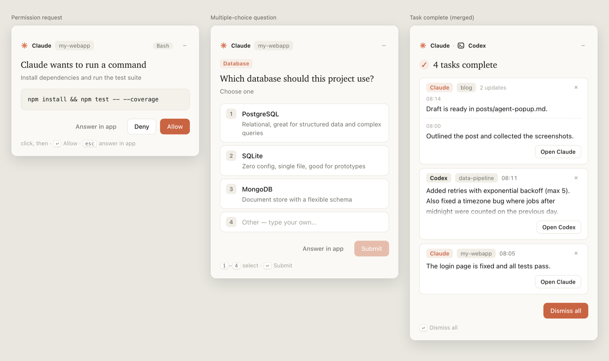

# coding-agent-popup

**给 macOS 上的 AI 编程 agent 做的醒目弹窗。** 当 Claude Code 或 Codex 需要你授权、问你问题、或者完成一个任务时，屏幕左下角会弹出一张像 Claude 那样的竖版卡片，而不是右上角那个一眨眼就消失的小通知。

零依赖。一个 JavaScript 文件 + macOS 自带的 `osascript` 和 `WKWebView`。

[English](README.md)



```
┌──────────────────────────────────────────────┐
│ ✳ Claude   my-webapp                         │
│                                              │
│ Claude 想要运行命令                           │
│ 安装依赖并运行测试                             │
│ ┌──────────────────────────────────────────┐ │
│ │ npm install && npm test -- --coverage    │ │
│ └──────────────────────────────────────────┘ │
│ ↩ 允许 · esc 去应用           [拒绝] [允许]   │
└──────────────────────────────────────────────┘
```

## 为什么

agent 的通知是你必须"在做别的事的时候注意到"的那类提示。大多数 agent 用的系统通知又小又短，27 寸屏幕上一不留神就错过了；而且想回应还得切回应用。

coding-agent-popup 默认把一张内容自适应高度的竖版卡片放在屏幕左下角（拖到别处后会记住新位置），并且允许你当场处理：

- **原地回答。** 允许或拒绝一条命令、选一个选项，不用切回终端。
- **合并任务完成。** 十个会话同时做完，是一个带列表的窗口，而不是十个弹窗。
- **一定等到你处理。** 不是 3 秒就消失的横幅，最多等你设定的时间。
- **从不挡路。** 你点"去应用里处理"、按 Esc、超时或者出错，都会交回 agent 原本的界面。
- **好看。** Claude 那种米白配陶土橙的配色、衬线标题，自动跟随深色模式。

## 功能

| | |
|---|---|
| 权限请求 | 显示具体的命令 / 文件改动 / 网址，直接允许或拒绝 |
| 选项提问 | 把 Claude Code 的 `AskUserQuestion` 选项渲染成卡片，最后一项可以自己输入 |
| 任务完成通知 | 跨会话、跨 agent 合并成一个窗口；同一 agent 同一项目的消息放在同一张卡片里，每张卡片有自己的“打开”按钮，直达对应会话 |
| 多个审批合并 | 同时来的审批放在同一个窗口里，每条一张卡片，当场逐条处理，不用一个个关弹窗 |
| 收起和记住位置 | 任何弹窗都能收起成右上角的小胶囊，点一下展开；拖动弹窗顶部或胶囊可以挪位置，下次还出现在那里 |
| 你在就不打扰 | agent 所在的应用正在最前面时，提示和回复你都看得到，就不弹。审批如果你没处理就切走了，会再弹出来：Claude 的可以直接在弹窗里审批；Codex 的因为已经交给 Codex 了，弹一张“还在等你审批”的提醒，点一下直达那个会话 |
| 跳回对应会话 | “打开”和“去应用里处理”会直接打开 Claude / Codex 桌面版里对应的那个会话（`claude://…` / `codex://threads/…`）；终端里的 agent 则把终端切到前台 |
| Markdown 渲染 | 任务完成的回复按 Markdown 显示：表格、列表、代码块、加粗、行内代码都正常排版；回复里的 HTML 一律当文字显示，不会被执行 |
| 不抢焦点 | 弹窗浮在最上层，但不会抢走键盘，你正在打的字不会被打断；要操作时点一下弹窗 |
| 快捷按键 | 先点一下弹窗（弹窗不会自己抢键盘），之后：`↩` 允许 / 确认 / 知道了，`esc` 交回应用或关闭，`1`–`9` 选择，`↑`/`↓` 移动 |
| 多显示器 | 出现在鼠标所在那块屏幕，浮在其他窗口和全屏应用之上 |
| 多个弹窗 | 自动错开，不会完全叠在一起 |
| 语言 | 中文或英文，跟随 macOS 语言（可用 `AGENT_POPUP_LANG=zh` 强制） |
| 深色模式 | 跟随系统外观 |
| 安全 | 键盘只有在你点过弹窗之后才会进到弹窗里，所以正在别处打字时按的回车不会误批命令 |

## 要求

- **仅支持 macOS**（用 `WKWebView` 和 JavaScript for Automation）。暂不支持 Windows 和 Linux。
- 以下之一或全部：
  - **Claude Code** —— 命令行版或桌面版，需支持 hooks
  - **Codex** —— 命令行版或桌面版，需支持 hooks
- 其他都不需要。运行时不用 Node、不用 Homebrew、不用 Python。

## 安装

```bash
git clone https://github.com/qivyn/coding-agent-popup.git
cd coding-agent-popup
./install.sh              # 自动检测已装的 Claude Code / Codex 并配置
# 或者明确指定：
./install.sh claude
./install.sh codex
```

安装脚本会把 `coding-agent-popup.js` 复制到 `~/.coding-agent-popup/`，把 hook 合并进你已有的配置（先备份），并打印改了什么。然后：

- **Claude Code**：新开一个会话（或重启应用）即可。
- **Codex**：hook 需要信任一次。在终端运行 `codex`，输入 `/hooks`，把 `PermissionRequest` 和 `Stop` 两个 hook 标为信任，然后重启 Codex（命令行版和桌面版都重启）。Codex 是按 hook 的具体命令记录信任的，之后只要改了 `~/.codex/hooks.json` 就要重新信任。

从 **agent-popup**（本项目的旧名字）升级：直接运行 `./install.sh` 即可。它会把旧 hook 换成新的、删掉 `~/.agent-popup`，并保留你拖好的弹窗位置。hook 命令变了，所以 Codex 会要求重新信任一次。

### 检查新版本

安装后，任务完成时会在后台检查本仓库的 GitHub 正式版 Release，所有会话共享检查记录，每 24 小时最多检查一次。发现比当前版本更新的正式版时会弹出提示，每个版本只提醒一次；点击「查看新版本」打开发布页。检查失败会静默跳过，断网或 GitHub 限流不会影响任务完成、审批和提问弹窗。没有使用项目时不会定时唤醒。

也可以随时手动检查（忽略每日间隔，在终端打印结果和发布页链接）：

```bash
osascript -l JavaScript ~/.coding-agent-popup/coding-agent-popup.js check-updates
```

检查功能只提示，不会自动下载或覆盖脚本。更新时，在原来的项目目录拉取代码并重新安装：

```bash
git pull --ff-only
./install.sh
```

如需关闭自动检查，在 agent 的环境变量里设置 `AGENT_POPUP_CHECK_UPDATES=0`；手动检查仍然可用。检查记录保存在 `~/.coding-agent-popup/updates.json`，卸载时一并删除。

维护者发布新版本时，需要同步修改 `package.json` 的 `version` 和脚本的 `VERSION`，并创建同版本号的 GitHub 正式版 Release（例如 `v0.2.0`）。只有 commit 或 tag、草稿和预发布版不会触发更新提醒。

### 先看看效果

```bash
osascript -l JavaScript ~/.coding-agent-popup/coding-agent-popup.js demo
```

用示例内容依次展示三种弹窗，语言跟随系统。只想看某一种：`demo ask`、`demo perm`、`demo done`；`demo codex` 看 Codex 风格的权限弹窗。

## 工作原理

Claude Code 和 Codex 都会在"准备问你什么"时触发 `PermissionRequest` hook，在一轮结束时触发 `Stop` hook。coding-agent-popup 各注册一条命令 hook：

- `PermissionRequest` → 从 stdin 读事件 JSON → 弹窗 → 输出决定（`allow` / `deny`，或者 `allow` 并带上 `updatedInput` 把你的答案传回去，这也是选项提问的实现方式）。Claude Code 在"可能要问你"的那一刻就触发这个 hook，这时它的自动模式分类器还可能自己把调用批准掉。所以对 Claude Code，弹窗会先静默等待，直到 Claude Code 发出自己的 `permission_prompt` 通知（请求大约 6 秒没人处理时才发），由第三个 hook `Notification` 转告过来。在这之前被批准的——分类器、规则，或者你在应用里点了——一律不弹。Codex 可以把审批交给它的自动审核（会话设置里 `approvals_reviewer: auto_review`），这时它根本不会问你，coding-agent-popup 也就不弹；只有 Codex 真的来问你时，才会立刻弹出——而且 Codex 会等这个弹窗：它先运行 hook，再显示自己的审批提示，所以只有弹窗没给出答案就关掉（点"去应用里处理"、按 `esc` 或超时）之后，Codex 应用里才会出现审批提示。弹窗打开期间也会继续盯着：一旦命令开始运行（出现在进程列表里）或者这次调用在会话记录里有了结果，就自动关掉，交给 agent 自己处理。
- `Stop` → 把通知写进队列 → 抢"窗口主人"锁。抢到的负责开窗口；没抢到的只是入队然后立刻退出，所以不会阻塞 agent。窗口主人每个 tick 检查队列里的新消息、刷新心跳；窗口关闭后先复查队列再释放锁，这样刚好在这一刻到达的消息也不会丢。窗口进程崩了，锁的心跳会过期，下一次会话直接接管。

界面是塞在无边框 `NSWindow` + `WKWebView` 里的自包含 HTML。万一 web 视图没加载出来，会自动退回系统原生对话框，不会让你丢失提示。

## 支持的 agent

| Agent | 权限弹窗 | 选项提问 | 完成通知合并 | 说明 |
|---|---|---|---|---|
| Claude Code | ✅ | ✅ | ✅ | 命令行版和桌面版 |
| Codex | ✅ | — | ✅ | 命令行版和桌面版（桌面版需较新版本的 hooks 支持） |
| 其他 | 看情况 | — | ✅ | hook JSON 格式一致即可，把名字作为第一个参数传入 |

接一个新的 agent 通常只需要一个名字。在它的 hook 配置里调用：

```bash
osascript -l JavaScript "$HOME/.coding-agent-popup/coding-agent-popup.js" <agent-name>
```

不认识的名字也能用——会用通用的终端图标，合并弹窗里显示它自己的名字。

## 配置

改 `~/.coding-agent-popup/coding-agent-popup.js` 顶部的常量：

| 常量 | 默认值 | 含义 |
|---|---|---|
| `TIMEOUT_SEC` | `180` | 提问/权限弹窗最多等多久，之后交回应用 |
| `DONE_TIMEOUT_SEC` | `600` | 完成通知窗口最多停留多久 |
| `WIN_WIDTH` | `400` | 弹窗宽度（点） |
| `STAGGER_PX` | `28` | 同时打开的弹窗之间错开的距离 |
| `GRACE_MS` | `1000` | Codex 等：权限弹窗先等多久再出现 |
| `PROMPT_WAIT_SEC` | `30` | Claude Code：如果一直等不到它的"需要你授权"通知，最多等这么久就照样弹出 |

语言：`AGENT_POPUP_LANG=en` 或 `zh`，不设就跟随 macOS 首选语言。
改完脚本后重新运行 `./install.sh` 复制过去（hook 配置没变，不需要重新信任）。

## 常见问题

**我在 Claude / Codex / 终端里的时候不弹窗。**
这是故意的：agent 所在的应用在最前面时，同样的提示或回复就在你眼前。审批还在等的时候你切到别的应用，弹窗会照常出现。对终端来说，“应用”指整个终端，所以在同一个终端的另一个标签页里也算。

**什么都不弹。**
先确认 hook 注册并启用：Claude Code 里输入 `/hooks`，Codex 里也是 `/hooks`。Codex 显示 `Installed: 0` 说明配置文件没被读到——重启 Codex，并确认文件在 `~/.codex/hooks.json`（或 `$CODEX_HOME/hooks.json`）。显示 `New hook — review required` 是还没信任。

**Codex 命令行版能弹，桌面版不弹。**
先在命令行版信任一次（`codex` → `/hooks`），然后彻底退出桌面版再打开（`⌘Q`，只关窗口不算）。如果桌面版仍然不认，可以改用 [examples/codex-config-notify.toml](examples/codex-config-notify.toml) 里的 `notify` 方式——只有完成通知、没有权限弹窗，并且要把 `Stop` hook 删掉，否则同一个任务会通知两次。

**弹出来的是系统原生对话框。**
说明自定义窗口没加载出来，走到了备用方案，功能仍然可用。想排查的话在“控制台”App 里找 `osascript` 的报错。

**agent 本来不用问的事也弹了窗。**
在 agent 的环境变量里设 `AGENT_POPUP_DEBUG=1`（Claude Code 写在 `~/.claude/settings.json` 的 `env` 里）。之后每个权限请求的工具名、权限模式和处理结果都会记到临时目录（`getconf DARWIN_USER_TEMP_DIR`）下的 `coding-agent-popup/debug.log`，不记录工具参数。

**第一次弹窗时 macOS 问是否允许。**
允许即可，创建窗口的脚本需要一次授权。

**有些命令没问就直接执行了。**
那是 agent 自己的授权设置允许的。coding-agent-popup 只能看到 agent 本来就要询问的请求，没办法让一个宽松的 agent 变严格。

**我的问题没有以卡片形式弹出。**
只有 Claude Code 有 `AskUserQuestion`；Codex 没有对应机制，它的提问仍然在应用里回答。

## 卸载

```bash
./uninstall.sh
```

从 `~/.claude/settings.json` 和 `~/.codex/hooks.json` 里移除本项目的 hook（保留你的其他设置和 hook，并留备份），然后删除 `~/.coding-agent-popup`。

## 隐私

全部在本地完成。脚本读取 hook 事件 JSON、最后一条回复（来自事件本身或本地会话记录），弹窗打开期间会在用户临时目录下写几个很小的队列文件。没有网络请求，没有埋点，不引入第三方代码。

## 开发

```bash
npm install     # jsdom，用于界面测试
npm test        # 62 个测试：弹窗界面、队列/锁逻辑、"已在别处处理"检测、安装脚本、hook 入口
npm run preview # 用当前 CSS 重新生成 docs/preview.html
```

测试把 macOS 专属的部分替换成了桩，所以在 Linux 和 CI 上也能跑。`docs/preview.html` 可以在任意浏览器里渲染三种弹窗，方便不安装就调样式。

## 许可

MIT。本项目与 Anthropic、OpenAI 无关；"Claude" 和 "Codex" 仅用于说明集成了哪些工具。

## 关键词

AI 编程 agent 弹窗、coding agent 通知、Claude Code 通知、Claude Code 弹窗、Claude Code hooks、Codex 通知、Codex hooks、AI 编程助手通知、
macOS 弹窗提醒、命令授权提醒、任务完成提醒、大屏幕通知、osascript JXA WKWebView 弹窗。
